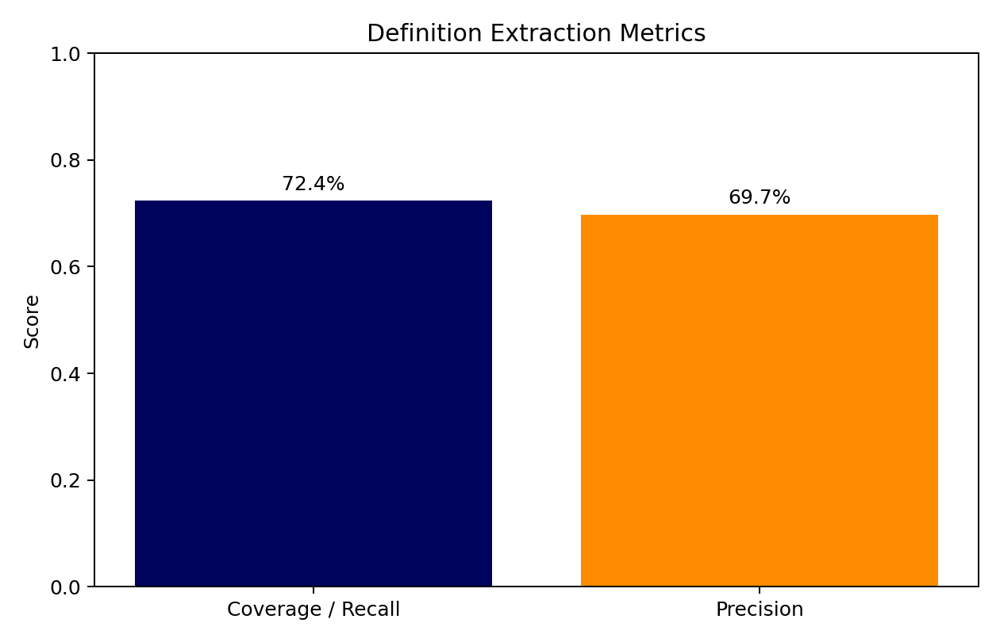
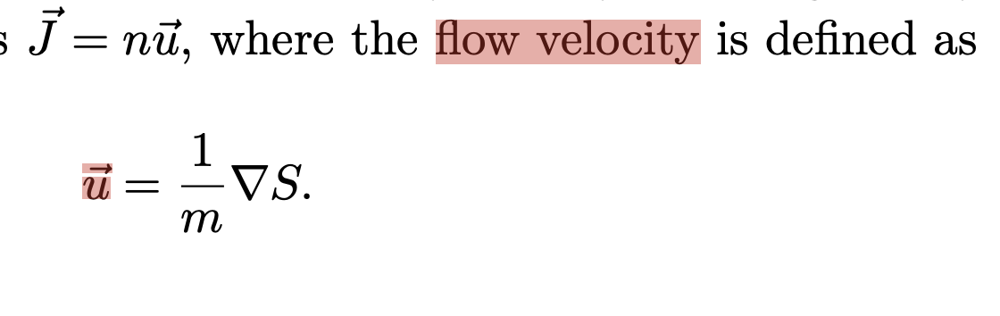
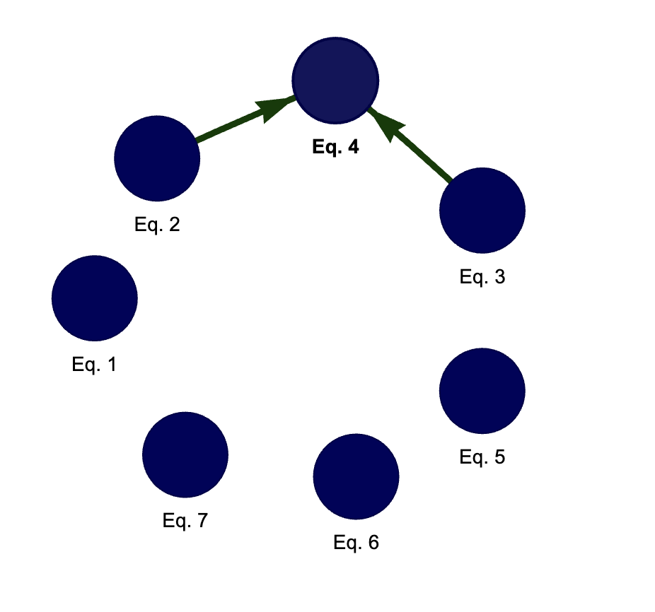

# Equation Extraction from Quantum Physics Papers (without LLMs)

An explainable NLP pipeline that pulls numbered equations out of arXiv quantum-physics papers and enriches each one with:

- the **symbols** it uses,
- a **definition** for each symbol, found in the paper's own text,
- a short **meaning** for the equation (e.g. "defines flow velocity"),
- **relations** to other equations in the same paper, graded *strong*, *potential* or *none*,
- an **audit trail** showing which rule produced each result.

No large language models are used. Every step is rule-based, scored, or based on dependency parsing, so each output can be traced back to the sentence and the rule that produced it.

Project for the *Natural Language Processing* course at OTH Amberg-Weiden (Summer 2026). The full write-up is in [`report/NLP_Project_Report.pdf`](report/NLP_Project_Report.pdf).

## Results

| | |
|---|---|
| Papers processed | 58 |
| Equations extracted | 350 (up to 7 per paper) |
| Symbols extracted | 2,554 |
| Symbols given a definition | 1,205 (47.2%) |
| Equation relations | 262 strong · 1,345 potential · 359 none |

**Symbol-definition evaluation** against 105 manually annotated symbols (21 equations from 4 papers):

| Metric | Value |
|---|---|
| Symbols resolved | 76 / 105 |
| Coverage (recall) | 72.38% |
| Correct among resolved | 53 / 76 |
| Precision | 69.74% |



> The evaluation was run on [`evaluation/final.json`](evaluation/final.json), the pipeline output used for the report's evaluation table. [`pipeline/dataset.json`](pipeline/dataset.json) is the final submitted dataset from a later run. The corpus statistics above describe that submitted dataset.

## How it works

```
arXiv IDs ─► Downloader ─► Parser ─► Symbol extractor ─► Context windows
                                                              │
   Final JSON ◄─ Relation graph ◄─ Equation meaning ◄─ Definition extractor
```

| Step | Module | What it does |
|---|---|---|
| 1 | `downloader.py` | Fetches the arXiv HTML (PDF as fallback) with rate limiting and a local cache. |
| 2 | `parser.py` | Finds numbered equations such as `(1)`, `(2a)`, `(S1)` and `(A.1)`, merges multi-line equations and keeps the surrounding text. When HTML isn't available, it converts the PDF to Markdown with `marker-pdf`. |
| 3 | `symbol_extractor.py` | Cleans the LaTeX and keeps the real symbols (Greek letters, sub/superscripts, hats, vectors) while dropping formatting commands and operators. |
| 4 | `local_context_window.py`, `global_context_window.py` | Builds sentence-level and section-level context around each equation. |
| 5 | `definition_extractor.py` | Matches symbols to definitions with spaCy and handcrafted patterns. It searches the text before the equation first, then the text after it, then local context, global context, and definitions from earlier in the same paper. A small dictionary of standard constants is the last resort. |
| 6 | `equation_context_builder.py` | Masks the equation as `EQ_n` and other maths as `MATH`, then uses dependency parsing to find the verb and noun phrase that describe it. Candidates are ranked by distance, dependency relation and position. |
| 7 | `graph_relationship.py` | Builds a directed graph between equations. Explicit references ("substituting Eq. (2)") and a left-hand side reused elsewhere count as **strong**; shared key symbols or similar context count as **potential**. |
| 8 | `create_final_json.py` | Writes everything, including the audit trail, to `dataset.json`. |

Example of a definition pattern (*"Y is defined as X"*) and of strong relations found in one paper:

<p>


</p>

### Output format

```json
"2506.06618": {
  "2": {
    "equation": "\\vec{u}=\\frac{1}{m}\\nabla S",
    "meaning": "EQ_2 defines flow velocity",
    "symbols": { "vec{u}": "flow velocity", "S": "both real-valued fields", ... },
    "relations": { "6": { "grade": "potential", "description": "defined quantity used in LHS" }, ... },
    "audit-trail": { ... }
  }
}
```

## Running it

```bash
cd pipeline
pip install -r requirements.txt
python -m spacy download en_core_web_sm
python main.py            # writes dataset.json
```

The pipeline reads the arXiv IDs in `paper_list_26.txt` in order until it has 350 equations. Downloads are cached in `pipeline/arxiv_cache/`, which is not tracked in git.

To reproduce the evaluation (needs `matplotlib`):

```bash
cd evaluation
python compare_symbol_metrics.py   # compares "Annotate symbols.xlsx" with final.json
```

## Limitations

- **PDF parsing:** symbols that look alike and multi-line equations can be misread when the HTML version isn't available.
- **Recall:** the definition rules only catch phrasings they were written for, so results vary with each author's writing style.
- **Equations stored as images** can't be extracted.
- **Annotations:** the ground truth was annotated by one person without a physics background.

## Repository layout

```
pipeline/       pipeline source, input paper list and the final dataset.json
evaluation/     evaluation script, manual annotations, evaluated output and metrics
report/         project report (PDF)
docs/images/    figures used in this README
```
